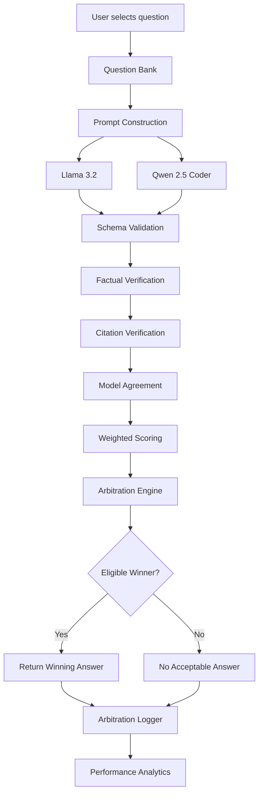

# LLM Output Arbitration System

A local AI Engineering system that evaluates responses from multiple Large Language Models (LLMs), verifies their correctness, scores their performance, and selects the most reliable eligible answer using a weighted arbitration policy.

Built with Python, Ollama and Pydantic as part of my AI Engineering journey through DeployEDU.

## Overview

Large Language Models can produce inconsistent, inaccurate or incorrectly formatted responses, even when given the same prompt.

The LLM Output Arbitration System addresses this challenge by generating responses from multiple models and evaluating them against predefined criteria before selecting a winner.

Rather than relying on response speed, model popularity or majority agreement alone, the system prioritizes factual correctness and structured response validation.

The entire inference pipeline runs locally without requiring paid AI APIs.

## Key Features

- Multi-model LLM inference.
- Structured JSON generation using Pydantic schemas.
- Response schema validation.
- Reference-based factual correctness verification.
- Citation and basic evidence verification.
- Cross-model agreement calculation.
- Weighted response scoring.
- Mandatory eligibility checks.
- Deterministic tie-breaking.
- Graceful model failure handling.
- Persistent arbitration logs using JSONL.
- Historical model performance analytics.
- Interactive command-line interface.
- Automated unit testing.

## Technology Stack

| Technology | Purpose |
|---|---|
| Python | Core application logic |
| Ollama | Local LLM inference |
| Pydantic | Structured output and schema validation |
| Llama 3.2 (1B) | Local language model |
| Qwen 2.5 Coder (1.5B) | Local language model |
| JSONL | Persistent arbitration logging |
| unittest | Automated testing |

## System Architecture



## How It Works

1. The user selects a question from the interactive question bank.
2. The system constructs a prompt containing the question and trusted sources.
3. Multiple LLMs independently generate structured JSON responses.
4. Pydantic validates each response against the required schema.
5. Extracted answers are compared against a trusted reference answer.
6. Citations are checked against the available trusted sources.
7. Agreement between valid model responses is calculated.
8. Each candidate receives a weighted evaluation score.
9. The arbitration engine selects the highest-scoring eligible candidate.
10. The decision, candidates, scores and selection reason are recorded.
11. Historical logs are used to calculate model performance statistics.

## Evaluation Rubric

Each candidate receives a maximum score of 100 points.

| Evaluation criterion | Maximum points |
|---|---:|
| Schema validity | 20 |
| Factual correctness | 50 |
| Citation evidence | 20 |
| Model agreement | 10 |
| **Total** | **100** |

The scoring formula is:

```text
Final Score =
    Schema Score
    + Factual Correctness Score
    + Evidence Score
    + (Agreement Ratio × 10)
```

Factual correctness carries the highest weight because the primary objective is to select a correct answer rather than simply a popular or well-formatted response.

## Arbitration Policy

A candidate must satisfy two mandatory requirements before becoming eligible to win:

- The response must pass schema validation.
- The answer must match the trusted reference answer.

The arbitration engine then selects the highest-scoring eligible candidate.

If multiple eligible candidates receive equal scores, the first eligible tied candidate is selected.

If no candidate passes the mandatory checks, the system returns:

```text
No acceptable answer found.
```

This prevents incorrect or invalid responses from being selected solely because of their numerical scores.

## Structured Output

The system uses Pydantic schemas with Ollama's structured output functionality to constrain model responses.

Expected response format:

```json
{
  "answer": "Abuja",
  "citation": "doc_001"
}
```

Structured generation improves response format compliance. However, it does not guarantee factual correctness.

For this reason, schema validation and factual evaluation remain separate components of the arbitration pipeline.

## Project Structure

```text
llm-output-arbitration/
│
├── main.py
├── model_client.py
├── validator.py
├── evaluator.py
├── citation_verifier.py
├── agreement.py
├── scorer.py
├── arbitrator.py
├── arbitration_logger.py
├── model_statistics.py
├── question_bank.py
│
├── test_validator.py
├── test_evaluator.py
├── test_citation.py
├── test_agreement.py
├── test_scorer.py
├── test_arbitrator.py
│
├── requirements.txt
├── .gitignore
└── README.md
```

The application generates an `arbitration_logs.jsonl` file at runtime. This file is excluded from version control.

## Component Responsibilities

| Component | Responsibility |
|---|---|
| `main.py` | Application orchestration and interactive CLI |
| `model_client.py` | Local LLM communication |
| `validator.py` | Response schema validation |
| `evaluator.py` | Reference-based factual evaluation |
| `citation_verifier.py` | Citation and basic evidence verification |
| `agreement.py` | Cross-model agreement calculation |
| `scorer.py` | Weighted candidate scoring |
| `arbitrator.py` | Eligibility checks and winner selection |
| `arbitration_logger.py` | Persistent decision logging |
| `model_statistics.py` | Historical performance analytics |
| `question_bank.py` | Benchmark questions, answers and trusted sources |

## Installation

### Prerequisites

- Python 3.13 (development environment)
- Ollama
- Git

Download and install Ollama from:

https://ollama.com/download

### 1. Clone the repository

```bash
git clone https://github.com/nicojoy-gif/llm-output-arbitration.git
cd llm-output-arbitration
```

### 2. Create a virtual environment

```bash
python -m venv .venv
```

Activate on Windows:

```powershell
.venv\Scripts\Activate.ps1
```

Activate on Linux or macOS:

```bash
source .venv/bin/activate
```

### 3. Install dependencies

```bash
python -m pip install -r requirements.txt
```

### 4. Download the required models

```bash
ollama pull llama3.2:1b
ollama pull qwen2.5-coder:1.5b
```

### 5. Start Ollama

Ensure Ollama is running. If it is not already running, execute:

```bash
ollama serve
```

### 6. Run the application

```bash
python main.py
```

## Interactive CLI

```text
==================================================
LLM OUTPUT ARBITRATION SYSTEM
==================================================

1. What is the capital of Nigeria?
2. What is the capital of Ghana?
3. Which planet is known as the Red Planet?
4. What is the largest organ in the human body?
5. View model statistics
0. Exit

Enter your choice:
```

## Example Arbitration Result

Question: What is the capital of Ghana?

```text
Model: llama3.2:1b
Answer: Accra
Schema valid: True
Factual correct: True
Evidence valid: True
Score: 100.0/100

Model: qwen2.5-coder:1.5b
Answer: Accra
Schema valid: True
Factual correct: True
Evidence valid: True
Score: 100.0/100

--- ARBITRATION RESULT ---
Winning model: llama3.2:1b
Answer: Accra
Citation: doc_001
Score: 100.0

Arbitration decision saved.
```

Both models returned correct answers and achieved equal scores. Llama was selected according to the deterministic tie-breaking policy.

## Arbitration Logging

Every arbitration attempt is recorded in a JSONL file.

Each new record contains:

- UTC timestamp.
- Original question.
- Candidate model responses.
- Validation and evaluation results.
- Agreement ratios.
- Candidate scores.
- Selected winner.
- Arbitration status.
- Tie indicator.
- Selection reason.

These records provide traceability and support historical performance analysis.

## Model Performance Analytics

The application calculates the following metrics for each model:

| Metric | Description |
|---|---|
| Attempts | Total model invocation attempts |
| Wins | Number of arbitration victories |
| Win rate | Percentage of attempts resulting in a win |
| Average score | Mean evaluation score |
| Schema success rate | Percentage of responses passing schema validation |

Run the analytics module independently:

```bash
python model_statistics.py
```

Alternatively, select the statistics option from the interactive CLI.

### Sample Development Results

Results collected across nine arbitration runs:

| Metric | Llama 3.2 | Qwen 2.5 Coder |
|---|---:|---:|
| Attempts | 9 | 9 |
| Wins | 4 | 3 |
| Win rate | 44.44% | 33.33% |
| Average score | 44.44 | 74.44 |
| Schema success rate | 44.44% | 77.78% |

These results include runs before and after structured output was introduced.

They demonstrate the analytics functionality but should not be interpreted as a comprehensive comparison of model capabilities.

Win rate is also influenced by the deterministic tie-breaking policy.

## Testing

The project includes manual test cases and automated unit tests covering the major evaluation components.

| Component | Test cases |
|---|---:|
| Schema validation | 9 |
| Factual correctness | 8 |
| Model agreement | 8 |
| Citation existence | 6 |
| Evidence verification | 9 |
| Scoring engine | 6 |
| Arbitration engine | 6 |
| **Total** | **52** |

### Test Results

- 40 manually verified test cases.
- 12 automated unit tests passed.
- Zero failures in the automated test suite.

Run the automated tests:

```bash
python -m unittest test_scorer test_arbitrator -v
```

Run test discovery, including the earlier manual test scripts:

```bash
python -m unittest discover -v
```

### Tested Arbitration Scenarios

- Highest-scoring eligible candidate wins.
- Incorrect answers cannot win.
- Invalid schemas cannot win.
- Equal scores trigger deterministic tie-breaking.
- All invalid candidates trigger graceful fallback.
- Empty candidate lists are handled safely.

## Engineering Challenges and Solutions

### Inconsistent JSON Responses

During development, models occasionally returned malformed JSON or wrapped otherwise correct responses in Markdown code fences.

**Solution:** Integrated Ollama structured output using Pydantic-generated JSON schemas.

### Incorrect Answers Receiving High Scores

Model agreement and valid formatting do not necessarily indicate factual correctness.

**Solution:** Introduced mandatory factual correctness and schema validation checks before winner selection.

### Model Inference Failures

Individual models may fail during inference.

**Solution:** Implemented exception handling so that a failed model does not prevent the remaining candidates from being evaluated.

### Unfair Performance Interpretation

A model may have a higher win rate because of tie-breaking rather than superior response quality.

**Solution:** Track multiple performance metrics instead of relying exclusively on win rate.

## Current Limitations

- Factual evaluation requires predefined trusted reference answers.
- Exact-match evaluation may reject semantically correct alternative answers.
- Citation verification uses substring matching rather than semantic entailment.
- Citation evidence contributes to scoring but is not currently a mandatory eligibility requirement.
- Model agreement does not independently establish factual correctness.
- Deterministic tie-breaking favors the first eligible model.
- Historical statistics currently combine different generation configurations.
- The benchmark question bank is small.
- The current implementation uses a command-line interface.

This project is a functional AI Engineering prototype rather than a production-grade factual verification platform.

## Future Improvements

- FastAPI backend integration.
- Next.js interactive dashboard.
- Semantic answer evaluation.
- Question-specific citation verification.
- Larger benchmark datasets.
- Configurable evaluation rubrics.
- Parallel model inference.
- Model latency and resource monitoring.
- Retry and fallback strategies.
- Configuration-aware performance analytics.
- Docker containerization.
- Expanded automated test coverage.
- Integration with retrieval-augmented generation systems.

## Key Learning Outcomes

Building this project strengthened my understanding of:

- Multi-model LLM orchestration.
- Structured AI output generation.
- AI guardrails and response validation.
- Deterministic evaluation strategies.
- Reference-based factual verification.
- Model agreement and its limitations.
- Weighted scoring and decision-making systems.
- AI observability and audit logging.
- Model performance evaluation.
- Modular Python application architecture.
- Automated software testing.

## Author

**Onyinyechi Orji**

Frontend Engineer transitioning into Full-Stack Development and AI Engineering.

- GitHub: https://github.com/nicojoy-gif
- LinkedIn: https://www.linkedin.com/in/orji-onyi/
- Portfolio: https://onyinyechi-orji.vercel.app/

## Acknowledgements

Built as part of the DeployEDU AI Engineering learning journey.

**Stage 7 — Project 1: LLM Output Arbitration System.**