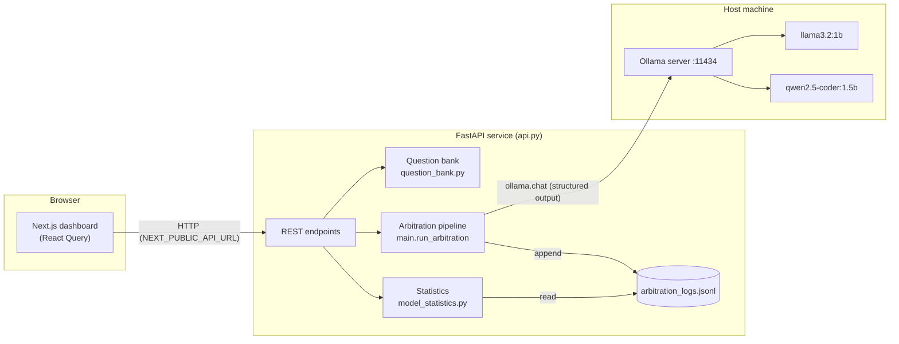
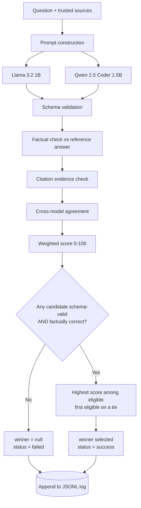

# Arbitra AI: LLM Output Arbitration System

**Evaluate. Verify. Decide.**

Arbitra AI is a local system for evaluating and arbitrating LLM outputs. It sends the same question to multiple local language models and validates each structured response. Each answer is checked against a trusted reference answer, its citation is checked against the provided sources, and agreement between the models is measured. The engine then selects the highest-scoring **eligible** answer, or returns no answer when none qualifies.

The system has three parts:

- a Python arbitration engine exposed through a FastAPI service;
- a Next.js observability dashboard;
- Docker Compose configuration that runs both against a host-side Ollama instance.

All inference runs locally. No paid AI APIs are used.

---

## Table of contents

1. [Project overview](#1-project-overview)
2. [Problem statement](#2-problem-statement)
3. [Key features](#3-key-features)
4. [System architecture](#4-system-architecture)
5. [Technology stack](#5-technology-stack)
6. [Project folder structure](#6-project-folder-structure)
7. [How the arbitration engine works](#7-how-the-arbitration-engine-works)
8. [Evaluation and scoring rubric](#8-evaluation-and-scoring-rubric)
9. [Winner selection, tie-breaking and failure handling](#9-winner-selection-tie-breaking-and-failure-handling)
10. [API endpoints](#10-api-endpoints)
11. [Frontend dashboard features](#11-frontend-dashboard-features)
12. [Local installation](#12-local-installation)
13. [Ollama model installation](#13-ollama-model-installation)
14. [Docker Compose setup](#14-docker-compose-setup)
15. [Persistent logging](#15-persistent-logging)
16. [Automated testing](#16-automated-testing)
17. [Docker-to-Ollama connectivity troubleshooting](#17-docker-to-ollama-connectivity-troubleshooting)
18. [Current limitations](#18-current-limitations)
19. [Future improvements](#19-future-improvements)
20. [Screenshots](#20-screenshots)

---

## 1. Project overview

The system compares two small local models served by Ollama:

| Model | Ollama identifier |
| --- | --- |
| Llama 3.2 (1B) | `llama3.2:1b` |
| Qwen 2.5 Coder (1.5B) | `qwen2.5-coder:1.5b` |

For each benchmark question, both models receive the same prompt and trusted sources. Each model must return a JSON object containing an answer and a source citation. Every response is scored against a fixed rubric. A response can only be selected if it is structurally valid **and** matches the trusted reference answer. Every decision is appended to a JSONL log, which drives the history view and the model performance analytics.

The project has three entry points:

- **FastAPI service** (`api.py`): HTTP API used by the dashboard.
- **Next.js dashboard** (`frontend/`): runs evaluations and inspects results, history and analytics.
- **Interactive CLI** (`main.py`): the original terminal interface, still available.

## 2. Problem statement

LLMs can return inconsistent, incorrectly formatted or factually wrong answers, even for the same prompt. Small local models are particularly prone to:

- malformed JSON, or JSON wrapped in Markdown code fences;
- confident but incorrect answers;
- citations that do not support the stated answer.

Picking the first response, the fastest response or the majority answer does not address these failure modes. Two models can agree on the same wrong answer, and a perfectly formatted response can still be incorrect.

This project explores a transparent, rule-based alternative. It applies explicit validation and verification checks, combines them into an auditable score, and requires structural validity and reference correctness before any answer can be selected. When no response meets those requirements, the system declines to answer instead of returning an unverified one.

## 3. Key features

- **Multi-model local inference.** Ollama serves the models, and each call uses a fixed temperature of `0.1`.
- **Structured output.** A Pydantic-generated JSON schema is passed to Ollama's `format` parameter.
- **Schema validation.** Each raw response is validated against the `ModelResponse` Pydantic model.
- **Reference-based factual verification.** Each answer is compared against a predefined trusted answer.
- **Citation evidence verification.** The cited source must exist and contain the answer text.
- **Cross-model agreement.** The share of valid answers that match each candidate is measured.
- **Weighted scoring.** Candidates are scored on a 0–100 scale using a fixed rubric.
- **Mandatory eligibility gate.** Schema validity and factual correctness are both required to win.
- **Deterministic tie-breaking.** The selection reason and tie status are recorded with each decision.
- **Graceful failure handling.** Model call failures and "no eligible answer" outcomes are handled without crashing.
- **Persistent JSONL audit log.** Every decision is stored, including timestamps and full candidate details.
- **Historical analytics.** Attempts, wins, win rate, average score and schema success rate are tracked per model.
- **REST API.** Built with FastAPI, with CORS configured for the dashboard.
- **Next.js dashboard.** Covers evaluation, history, analytics and a rubric explanation.
- **Containerised deployment.** Docker Compose runs the backend and frontend.
- **Unit tests.** Cover the scoring and arbitration logic.

## 4. System architecture



Arbitration pipeline for a single request:



The browser calls the FastAPI service directly. The frontend has no server-side data fetching or proxy.

## 5. Technology stack

| Layer | Technology | Purpose |
| --- | --- | --- |
| Inference | Ollama, `ollama` Python client 0.6.2 | Local model serving and chat API |
| Models | Llama 3.2 (1B), Qwen 2.5 Coder (1.5B) | Candidate generators |
| Validation | Pydantic 2.13 | Response schema and JSON schema generation |
| API | FastAPI 0.165, Uvicorn 0.54 | REST service |
| Persistence | JSON Lines file | Append-only arbitration log |
| Testing | Python `unittest` | Unit tests for scoring and arbitration |
| Frontend | Next.js 16 (App Router), React 19, TypeScript | Dashboard application |
| UI | Tailwind CSS v4, shadcn/ui (Radix UI), Lucide | Components, styling, icons |
| Data fetching | TanStack React Query | Server state, caching, invalidation |
| Charts and feedback | Recharts, Sonner | Analytics charts and toast notifications |
| Containers | Docker, Docker Compose | Backend (`python:3.13-slim`) and frontend (`node:22-alpine`) images |

## 6. Project folder structure

```text
llm-output-arbitration/
├── api.py                    FastAPI application and endpoints
├── main.py                   Arbitration pipeline (run_arbitration) and interactive CLI
├── model_client.py           Ollama chat call with structured output and error handling
├── validator.py              Pydantic ModelResponse schema and validation
├── evaluator.py              Reference-based factual correctness check
├── citation_verifier.py      Citation existence and evidence check
├── agreement.py              Cross-model agreement calculation
├── scorer.py                 Weighted 0–100 scoring
├── arbitrator.py             Eligibility gate and winner selection
├── arbitration_logger.py     JSONL logging with tie status and selection reason
├── model_statistics.py       Log loading and per-model metrics
├── question_bank.py          Benchmark questions, reference answers and trusted sources
├── test_arbitrator.py        unittest suite: winner selection
├── test_scorer.py            unittest suite: scoring
├── test_agreement.py         Exploratory check script (prints output)
├── test_citation.py          Exploratory check script (prints output)
├── test_evaluator.py         Exploratory check script (prints output)
├── test_validator.py         Exploratory check script (prints output)
├── requirements.txt          Python dependencies
├── Dockerfile                Backend image
├── .dockerignore
├── docker-compose.yml        Backend and frontend services
├── arbitration_logs.jsonl    Runtime log (git-ignored, created at runtime)
└── frontend/
    ├── Dockerfile            Multi-stage frontend image
    ├── .env                  Optional NEXT_PUBLIC_API_URL override (git-ignored)
    ├── package.json
    └── src/
        ├── app/              Routes: /, /evaluate, /history, /analytics, /rubric
        ├── components/       layout, evaluation, dashboard, analytics, history, rubric, shared, ui
        ├── hooks/            React Query hooks
        ├── services/         API client and arbitration service
        ├── lib/              Score breakdown, tie detection, response normalisation, formatting
        ├── constants/        Model metadata, scoring weights, navigation
        ├── providers/        Query and theme providers
        └── types/            TypeScript API types
```

## 7. How the arbitration engine works

`main.run_arbitration(question, expected_answer, trusted_sources)` runs these steps:

1. **Prompt construction.** The prompt contains the question and the trusted source dictionary, for example `{"doc_001": "Accra is the capital of Ghana.", "doc_002": "Kumasi is a city in Ghana."}`. It instructs the model to return only `{"answer": "...", "citation": "source ID"}`, to use only the provided source IDs, and to return `null` as the citation if no source supports the answer.
2. **Inference.** Each model in `MODELS` is called **sequentially** through `ollama.chat`. The call uses `temperature=0.1` and passes `format=ModelResponse.model_json_schema()` to request schema-constrained output. If a model call raises an exception, the error is printed and the raw response is recorded as `null`.
3. **Schema validation.** The raw string is parsed with `ModelResponse.model_validate_json`. The schema is `answer: str` and `citation: str | None`. Malformed JSON, missing fields or wrong types make the candidate schema-invalid. Its extracted answer and citation are then `null`.
4. **Factual verification.** The extracted answer is compared with the question's reference answer as a case-insensitive exact match after trimming whitespace.
5. **Evidence verification.** The citation must be a key in the question's trusted sources. The cited source text must also contain the answer as a case-insensitive substring.
6. **Agreement.** The engine collects the normalised (trimmed, lower-cased) answers of all schema-valid candidates with non-empty answers. Each candidate's agreement ratio is the share of those answers that equal its own answer. The ratio is `0` when fewer than two valid answers exist.
7. **Scoring.** Each candidate is scored with the rubric below, and scores are rounded to two decimal places.
8. **Selection.** The arbitrator applies the eligibility gate and selects a winner (see [section 9](#9-winner-selection-tie-breaking-and-failure-handling)).
9. **Logging.** The full decision is appended to `arbitration_logs.jsonl`. This includes the timestamp, the candidates, the winner, the status, the tie flag and the selection reason.

The current question bank contains four benchmark questions, each with one reference answer and two trusted sources:

| ID | Question | Reference answer |
| --- | --- | --- |
| 1 | What is the capital of Nigeria? | Abuja |
| 2 | What is the capital of Ghana? | Accra |
| 3 | Which planet is known as the Red Planet? | Mars |
| 4 | What is the largest organ in the human body? | Skin |

The `/questions` endpoint exposes only IDs and question text. Reference answers and sources are never sent to the client.

## 8. Evaluation and scoring rubric

| Criterion | Points | Awarded when |
| --- | ---: | --- |
| Schema validation | 20 | The raw response validates against `ModelResponse` |
| Factual correctness | 50 | The normalised answer exactly matches the reference answer |
| Evidence verification | 20 | The citation exists in the trusted sources and its text contains the answer |
| Model agreement | 10 | `agreement_ratio × 10` (proportional, not all-or-nothing) |
| **Total** | **100** | |

Implementation (`scorer.py`):

```python
score = 20 * schema_valid + 50 * factual_correct + 20 * evidence_valid + 10 * agreement_ratio
```

With two models:

- If both give the same valid answer, each gets an agreement ratio of `1.0` (10 points).
- If they give different valid answers, each gets `0.5` (5 points).
- If only one response is schema-valid, agreement is `0` for both.

Important caveats:

- **Agreement does not guarantee factual correctness.** Two models can agree on the same wrong answer. Agreement therefore carries the smallest weight, and it cannot make a candidate eligible on its own.
- **Factual verification depends on predefined benchmark answers.** The check only works for questions in the question bank that have a known reference answer. It cannot verify open-ended questions.
- **Citation verification is basic text matching.** It checks that the source ID exists and that the answer appears as a substring of the source text. It does not perform semantic or entailment-based verification.
- **Structured output does not imply correctness.** A schema-valid response proves the format was followed, not that the content is true.

## 9. Winner selection, tie-breaking and failure handling

**Eligibility gate (`arbitrator.py`).** A candidate is eligible only if it is both schema-valid **and** factually correct. Evidence and agreement affect the score but are not mandatory for eligibility.

**Selection.** The eligible candidate with the highest score wins.

**Tie-breaking.** When several eligible candidates share the highest score, the first one in evaluation order wins. Models are evaluated in the order of the `MODELS` list (`llama3.2:1b`, then `qwen2.5-coder:1.5b`), so Llama wins every tie.

The tie-break is deterministic and reproducible, but it is **not** a quality judgement. A win from a tie does not mean the selected model is better or more accurate than the other tied candidate. Win rate is therefore biased towards the first model in the list and should not be read as an independent accuracy metric. The logger records `"tie": true` and the reason `"Equal highest scores. First eligible tied candidate selected."` so tie-based wins can be told apart from score-based wins.

**Failure handling.**

| Situation | Behaviour |
| --- | --- |
| A model call raises an exception (for example, Ollama unreachable or model not pulled) | Error printed to the server log. The raw response is `null`, the candidate fails every check and scores 0, and the other models are still evaluated. |
| No candidate passes the gate | `winner` is `null`, `status` is `"failed"` and the reason is `"No candidate passed the mandatory checks."` The API still returns HTTP 200 with every candidate's details, and the run is logged. |
| Unknown `question_id` | HTTP 404 with `{"detail": "Question not found"}`. Nothing is logged. |
| Malformed request body | HTTP 422 (FastAPI request validation). |

The system never builds a fallback answer: when no candidate is eligible, no answer is returned.

## 10. API endpoints

Base URL: `http://localhost:8000`. Interactive OpenAPI documentation is available at `http://localhost:8000/docs`.

CORS allows `http://localhost:3000` and `http://127.0.0.1:3000`.

### `GET /`

Health check.

```json
{ "message": "LLM Arbitration API is running", "status": "healthy" }
```

### `GET /questions`

Returns question IDs and text only.

```json
[
  { "id": 1, "question": "What is the capital of Nigeria?" },
  { "id": 2, "question": "What is the capital of Ghana?" },
  { "id": 3, "question": "Which planet is known as the Red Planet?" },
  { "id": 4, "question": "What is the largest organ in the human body?" }
]
```

### `POST /arbitrate`

Runs a full arbitration. The call blocks until both models have responded, which can take from several seconds to over a minute on a cold start.

Request:

```json
{ "question_id": 2 }
```

Response (successful arbitration, tied scores):

```json
{
  "question": "What is the capital of Ghana?",
  "candidates": [
    {
      "model_name": "llama3.2:1b",
      "answer": "{\"answer\":\"Accra\",\"citation\":\"doc_001\"}",
      "temperature": 0.1,
      "schema_valid": true,
      "validated_answer": "Accra",
      "factual_correct": true,
      "citation": "doc_001",
      "evidence_valid": true,
      "agreement_ratio": 1.0,
      "score": 100.0
    },
    {
      "model_name": "qwen2.5-coder:1.5b",
      "answer": "{\"answer\":\"Accra\",\"citation\":\"doc_001\"}",
      "temperature": 0.1,
      "schema_valid": true,
      "validated_answer": "Accra",
      "factual_correct": true,
      "citation": "doc_001",
      "evidence_valid": true,
      "agreement_ratio": 1.0,
      "score": 100.0
    }
  ],
  "winner": { "model_name": "llama3.2:1b", "validated_answer": "Accra", "citation": "doc_001", "score": 100.0, "...": "..." },
  "status": "success"
}
```

The full `winner` object has the same fields as a candidate; it is shortened here. When no candidate is eligible, `winner` is `null` and `status` is `"failed"`. The fields `answer`, `validated_answer` and `citation` can each be `null`. The `answer` field is the raw model output string. The `tie` and `selection_reason` fields are written to the log but not included in this response.

Errors: `404 {"detail": "Question not found"}`, `422` for an invalid body.

### `GET /statistics`

Aggregates the log. Every rate is already a percentage (0–100), rounded to two decimals.

```json
{
  "total_runs": 17,
  "successful_runs": 15,
  "failed_runs": 2,
  "success_rate": 88.24,
  "models": {
    "llama3.2:1b": {
      "attempts": 17, "wins": 12, "total_score": 1200.0, "valid_responses": 12,
      "win_rate": 70.59, "average_score": 70.59, "schema_success_rate": 70.59
    },
    "qwen2.5-coder:1.5b": {
      "attempts": 17, "wins": 3, "total_score": 1470.0, "valid_responses": 15,
      "win_rate": 17.65, "average_score": 86.47, "schema_success_rate": 88.24
    }
  }
}
```

The values above illustrate the response shape. They come from a development log and are not a benchmark result. With an empty log, the totals are `0` and `models` is `{}`.

### `GET /history`

Returns every logged arbitration, newest first.

```json
[
  {
    "timestamp": "2026-11-28T03:24:24.669307+00:00",
    "question": "What is the capital of Nigeria?",
    "candidates": [ { "model_name": "llama3.2:1b", "...": "..." } ],
    "winner": { "model_name": "llama3.2:1b", "...": "..." },
    "status": "success",
    "tie": true,
    "selection_reason": "Equal highest scores. First eligible tied candidate selected."
  }
]
```

Records written by earlier versions of the logger may not include `tie` or `selection_reason`. When these fields are missing, the dashboard works them out from the candidates.

## 11. Frontend dashboard features

The dashboard is a client-rendered Next.js application. It reads all data from the API and contains no mock or placeholder statistics.

- **Layout.** A collapsible sidebar becomes a drawer on mobile. The sidebar shows a local inference indicator, the backend connection status (the health endpoint is polled every 15 seconds) and the app version. The header has breadcrumbs, a connection indicator and a light/dark theme toggle that follows the system preference by default.
- **Overview.** Summary cards show total, successful and failed runs and the overall success rate. The page also has a grouped bar chart comparing the models, cards for each active model (average score, win rate, schema success rate) and the five most recent runs.
- **Run Evaluation.** Questions are loaded from `/questions`, and both participating models are shown before a run.
  - While a run is in progress, the page shows a loading state with elapsed time. It does not show simulated pipeline stages, because the backend returns a single response.
  - A synchronous in-flight guard prevents duplicate submissions, and the arbitration request is never retried automatically.
  - Each candidate gets a comparison card with:
    - the extracted answer, citation and temperature;
    - check and cross indicators for schema, factual and evidence checks;
    - the agreement percentage;
    - per-criterion progress bars;
    - a collapsible raw-response viewer that shows invalid JSON verbatim with the parser error.
  - The winning candidate is highlighted. Ties are labelled and explained as deterministic tie-breaks.
  - Failed arbitrations show "No acceptable answer found." with an explanation, and no answer is shown.
- **Evaluation History.** A searchable table can be filtered by winning model, status and question. Selecting a row opens a drawer with the full candidate comparison and decision.
- **Model Analytics.** Per-model attempt, win, win-rate, average-score and schema-success figures. Also includes a grouped score chart, win-rate and schema-success comparison charts, and a detailed comparison table. The page carries a note that win rate is affected by tie-breaking and that the historical data is not a controlled benchmark.
- **Evaluation Rubric.** A pipeline diagram, the scoring weights, the eligibility rules and the current limitations.
- **Shared behaviour.**
  - Each data view has loading, empty and error states, including a "backend not reachable" state.
  - History and statistics refresh automatically after every arbitration, whether it succeeds or fails.
  - The layout works at mobile, tablet and desktop widths.

## 12. Local installation

### Prerequisites

- Python 3.10 or later. The Docker image uses Python 3.13.
- Node.js 20.9 or later. The Docker image uses Node 22.
- [Ollama](https://ollama.com/) installed and running.

### Backend

```bash
git clone https://github.com/nicojoy-gif/llm-output-arbitration.git
cd llm-output-arbitration

python -m venv .venv
# Windows (PowerShell)
.venv\Scripts\Activate.ps1
# macOS / Linux
source .venv/bin/activate

pip install -r requirements.txt

uvicorn api:app --reload --port 8000
```

Run the backend from the repository root. The log file path is relative to the working directory.

To use the original command-line interface instead of the API:

```bash
python main.py
```

### Frontend

```bash
cd frontend
npm install
npm run dev
```

Open http://localhost:3000.

No environment file is needed for the default setup: when `NEXT_PUBLIC_API_URL` is not set, the dashboard calls `http://localhost:8000`. To use a different backend, set the variable in `frontend/.env` or `frontend/.env.local` (`.env.local` takes precedence). Both files are git-ignored, so a fresh clone has neither:

```env
NEXT_PUBLIC_API_URL=http://localhost:8000
```

`NEXT_PUBLIC_*` variables are inlined at build time. Restart the dev server, or rebuild, after changing the value.

| Frontend script | Purpose |
| --- | --- |
| `npm run dev` | Development server |
| `npm run build` | Production build, including type checking |
| `npm start` | Serve the production build |
| `npm run lint` | ESLint |

## 13. Ollama model installation

Install Ollama from https://ollama.com/download, then pull both models:

```bash
ollama pull llama3.2:1b
ollama pull qwen2.5-coder:1.5b
```

Confirm that both are available and that the server is listening on the default port, `11434`:

```bash
ollama list
curl http://localhost:11434/api/tags
```

The desktop application starts the server automatically. Otherwise, run `ollama serve`.

## 14. Docker Compose setup

`docker-compose.yml` defines two services. **Ollama itself is not containerised**: it must be running on the host with both models pulled.

| Service | Image base | Published port | Notes |
| --- | --- | --- | --- |
| `backend` | `python:3.13-slim` | `127.0.0.1:8000 → 8000` | Uvicorn on `0.0.0.0:8000`, `restart: unless-stopped` |
| `frontend` | `node:22-alpine` (multi-stage) | `127.0.0.1:3000 → 3000` | `next start`, built with `NEXT_PUBLIC_API_URL=http://localhost:8000`, `depends_on: backend` |

Both ports are bound to `127.0.0.1`, so the services are reachable only from the host machine.

**Networking configuration:**

- **Backend to Ollama.**
  - The backend container sets `OLLAMA_HOST=http://host.docker.internal:11434`, which the `ollama` Python client reads to locate the server.
  - `extra_hosts: "host.docker.internal:host-gateway"` maps that hostname to the host's gateway address. This makes the name resolve on Linux as well as on Docker Desktop.
- **Browser to backend.**
  - The frontend is built with `NEXT_PUBLIC_API_URL=http://localhost:8000`, so the user's browser calls the backend through its published host port, not over the Compose network.
  - The frontend container never calls the backend server-side.
  - CORS in `api.py` allows `http://localhost:3000` and `http://127.0.0.1:3000`.

**Start the stack.** First create the log file, so Docker bind-mounts a file rather than creating a directory (see [section 15](#15-persistent-logging)):

```bash
# macOS / Linux
touch arbitration_logs.jsonl
# Windows (PowerShell)
if (-not (Test-Path arbitration_logs.jsonl)) { New-Item arbitration_logs.jsonl }

docker compose up --build -d
```

Then open http://localhost:3000. The API is available at http://localhost:8000.

Useful commands:

```bash
docker compose ps
docker compose logs -f backend
docker compose down
```

Because `NEXT_PUBLIC_API_URL` is a build argument, rebuild the frontend image after changing it:

```bash
docker compose build frontend
```

## 15. Persistent logging

Every arbitration, successful or failed, is appended as one JSON object per line to `arbitration_logs.jsonl` in the process's working directory. The file is opened per write in append mode.

Each entry contains:

| Field | Description |
| --- | --- |
| `timestamp` | UTC ISO-8601 timestamp |
| `question` | Question text |
| `candidates` | Full candidate records, including raw responses, checks, agreement and scores |
| `winner` | Winning candidate, or `null` |
| `status` | `"success"` or `"failed"` |
| `tie` | Whether several eligible candidates shared the winning score |
| `selection_reason` | Human-readable reason for the decision |

This log is the only data store. `/statistics` and `/history` read it on every request.

- **Local development.** The file is created on the first arbitration. It is listed in `.gitignore`.
- **Docker.** The file is excluded from the image by `.dockerignore` and bind-mounted from the host (`./arbitration_logs.jsonl:/app/arbitration_logs.jsonl`), so records survive container rebuilds and are shared with local runs.
- **Create the file before the first `docker compose up`.** If the host file does not exist, Docker creates a *directory* at that path, and writing the log then fails.

To reset the history, stop the services and empty the file. Do not delete it.

## 16. Automated testing

### Backend

`test_arbitrator.py` and `test_scorer.py` are `unittest` suites with assertions, 12 test cases in total. They cover:

- the highest score winning;
- schema-invalid and factually incorrect candidates being unable to win;
- tie-breaking in favour of the first eligible candidate;
- all candidates failing, and an empty candidate list;
- exact scores for perfect, zero, partial-agreement and missing-citation cases.

```bash
python -m unittest -v test_arbitrator test_scorer
```

`test_agreement.py`, `test_citation.py`, `test_evaluator.py` and `test_validator.py` are exploratory scripts. They print the results of edge-case inputs (whitespace, casing, `null` values, malformed JSON, unknown citations) for manual inspection, but contain no assertions:

```bash
python test_validator.py
```

None of the tests call Ollama, so they run without the models installed.

### Frontend

The frontend has no automated test suite. Static checks are available:

```bash
cd frontend
npm run lint
npm run build    # includes TypeScript type checking
```

## 17. Docker-to-Ollama connectivity troubleshooting

When the backend container cannot reach Ollama, the API still responds. Each model call fails and is caught, so arbitrations return `status: "failed"` with `null` raw responses instead of an HTTP error. The backend log shows the underlying cause:

```bash
docker compose logs backend | grep "failed:"
# e.g. Model llama3.2:1b failed: ...
```

**1. Confirm Ollama is running on the host.**

```bash
curl http://localhost:11434/api/tags
```

**2. Test connectivity from inside the container.** The slim image has no `curl`, so use the installed Python client:

```bash
docker compose exec backend python -c "import ollama; print([m.model for m in ollama.list().models])"
```

If this lists both models, connectivity is working. If it raises a connection error, continue below.

**3. Linux: Ollama is bound to localhost only.**

By default Ollama listens on `127.0.0.1:11434`. On Linux, `host-gateway` resolves to the Docker bridge address (typically `172.17.0.1`), which cannot reach a service bound only to loopback. Make Ollama listen on all interfaces, for example with a systemd override:

```bash
sudo systemctl edit ollama
# add:
# [Service]
# Environment="OLLAMA_HOST=0.0.0.0"
sudo systemctl daemon-reload
sudo systemctl restart ollama
```

This exposes Ollama on the host's network interfaces. Restrict access with a firewall if the machine is on an untrusted network.

**4. Docker Desktop (Windows and macOS).** `host.docker.internal` is provided by Docker Desktop and normally reaches Ollama without extra configuration. If it does not, check that no firewall or VPN is blocking port `11434` and that the Ollama application is running.

**5. Models missing.** If the error mentions a model not being found, pull the models on the **host** (not inside the container) as described in [section 13](#13-ollama-model-installation).

**6. Slow first request.** The first arbitration after startup loads both models into memory and can take noticeably longer. The frontend shows elapsed time and does not time out the request.

**7. The browser cannot reach the API.** Confirm that `http://localhost:8000/` responds on the host. Also check that the dashboard is opened at `http://localhost:3000` or `http://127.0.0.1:3000`, since other origins are not allowed by the CORS configuration.

## 18. Current limitations

- **Reference answers are required.** Factual verification depends on predefined benchmark answers, so only the four questions in `question_bank.py` can be evaluated.
- **Exact matching.** Correct answers phrased differently (for example "The capital is Abuja" or "the skin") are marked incorrect.
- **Basic citation checks.** Evidence verification is text matching, not semantic verification. Because it checks whether the answer is a substring of the cited text, a very short answer can match by coincidence. Evidence is also not required for eligibility.
- **Agreement is not correctness.** Agreement measures consensus between two small models. They can agree on the same wrong answer.
- **Tie-break bias.** Ties always go to the first model in `MODELS`. This makes win rate a poor measure of model quality.
- **Not a controlled benchmark.** Historical statistics combine every logged run, including runs made under earlier prompts or configurations.
- **Sequential, synchronous inference.** Models run one after another inside the request, so latency grows with each added model, and long requests occupy a server worker.
- **Fixed configuration.** The models, temperature, prompt and rubric weights are hard-coded.
- **File-based storage.** A single JSONL file has no locking, indexing or retention policy, and every statistics request re-reads the whole file.
- **No authentication or rate limiting.** The API is intended for local use. Docker publishes it on `127.0.0.1` only.
- **Limited test coverage.** Validation, evaluation, citation and agreement have exploratory scripts without assertions. There are no API or frontend tests.

This is a functional AI engineering prototype, not a production-grade factual verification platform.

## 19. Future improvements

- Semantic answer evaluation (normalisation rules, embedding similarity or an LLM judge with its own safeguards).
- Entailment-based citation verification, with an option to make evidence mandatory.
- A larger, versioned benchmark dataset with per-question metadata.
- Configurable models, prompts, temperatures and rubric weights, recorded with each log entry so analytics can be grouped by configuration.
- A tie-break policy that does not favour a fixed model (for example random with a seed, or by latency), reported separately from score-based wins.
- Parallel or asynchronous model inference, with per-model latency and token tracking.
- Streaming progress events so the dashboard can show real pipeline stages.
- A database such as SQLite or PostgreSQL in place of the JSONL file.
- Converting the exploratory scripts into assertion-based tests, and adding API tests (FastAPI `TestClient`) and frontend tests.
- An optional Ollama service in Docker Compose, for a fully containerised setup on machines with GPU support.

## 20. Screenshots

Screenshots have not been added to the repository yet. Suggested captures, to be stored under `docs/screenshots/`:

| View | Suggested file |
| --- | --- |
| Overview dashboard | `docs/screenshots/overview.png` |
| Run Evaluation, winning result with tie explanation | `docs/screenshots/evaluation-result.png` |
| Run Evaluation, "No acceptable answer found." | `docs/screenshots/evaluation-failed.png` |
| Evaluation History with details drawer | `docs/screenshots/history-drawer.png` |
| Model Analytics | `docs/screenshots/analytics.png` |
| Evaluation Rubric | `docs/screenshots/rubric.png` |

Once a file is added, it can be embedded like this:

```markdown

```

---

## Author

**Onyinyechi Orji**

Frontend Engineer transitioning into Full-Stack Development and AI Engineering.

- GitHub: https://github.com/nicojoy-gif
- LinkedIn: https://www.linkedin.com/in/orji-onyi/
- Portfolio: https://onyinyechi-orji.vercel.app/

## Acknowledgements

Built as part of the DeployEDU AI Engineering learning journey: **Stage 7, Project 1: LLM Output Arbitration System.**
